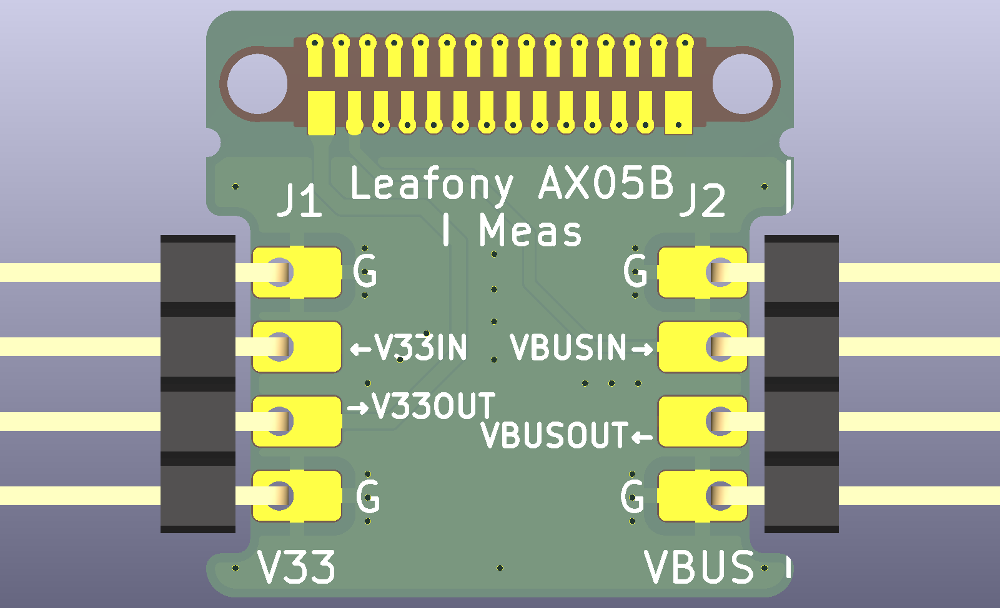
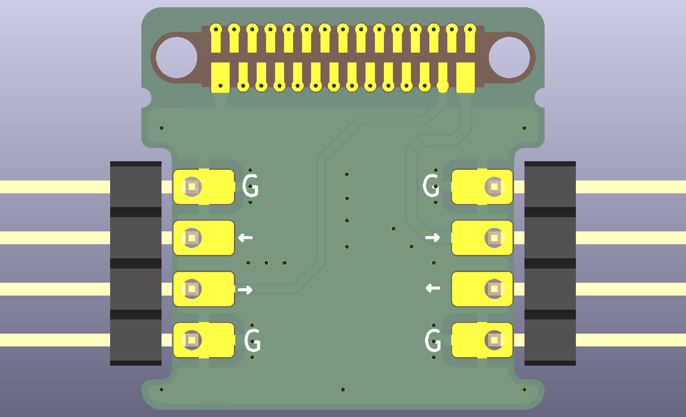

# Leafony AX05B

Leafony AX05B I Measは、Leafonyバスの`V33`と`VBUS`の電流測定用リーフです。
Nordic Power Profiler Kit II（PPK2）などの外部電流測定器を電源ラインに直列に入れられるよう、`V33`と`VBUS`をそれぞれ`IN`/`OUT`に分離しています。

| Top | Bottom |
| --- | --- |
|  |  |

## 仕様

| 項目 | 内容 |
| --- | --- |
| リーフ名 | Leafony AX05B I Meas |
| 用途 | Leafonyバスの電源ライン電流測定 |
| 測定対象 | `V33`、`VBUS` |
| バスコネクタ | Leafony Bus（F29/B29） |
| 測定コネクタ | 1x4、2.54mmピッチ、ライトアングルピンヘッダ x 2 |
| 基板外形 | 20mm x 20mm |
| 基板厚 | 0.8mm |
| 層構成 | 2層 |
| 表面処理 | ENIG（Immersion gold） |
| 回路図 | [docs/leafony-ax05b-sch.pdf](docs/leafony-ax05b-sch.pdf) |
| レイアウト | [docs/leafony-ax05b-layout.pdf](docs/leafony-ax05b-layout.pdf) |

## 測定コネクタ

`J1`が`V33`、`J2`が`VBUS`です。どちらもピン配置は同じです。

| ピン | J1（V33） | J2（VBUS） | 用途 |
| --- | --- | --- | --- |
| 1 | `GND` | `GND` | 測定器のGND |
| 2 | `V33OUT` | `VBUSOUT` | 測定後の出力側 |
| 3 | `V33IN` | `VBUSIN` | 測定前の入力側 |
| 4 | `GND` | `GND` | 測定器のGND |

## Nordic Power Profiler Kit IIでの電流測定

PPK2を電流計として使用し、測定したい電源ラインの`IN`と`OUT`の間に直列接続します。

- `V33`を測定する場合: `J1`の`V33IN`と`V33OUT`の間にPPK2を接続します。
- `VBUS`を測定する場合: `J2`の`VBUSIN`と`VBUSOUT`の間にPPK2を接続します。
- GND基準が必要な場合は、同じコネクタの`GND`ピンをPPK2のGNDへ接続します。

測定しない電源ラインは、`IN`と`OUT`をジャンパーでショートしてください。
例えば`V33`を測定しない場合は`J1`の2-3ピンを、`VBUS`を測定しない場合は`J2`の2-3ピンをショートします。
両方を測定しない通常使用時は、`J1`と`J2`の両方で2-3ピンをショートしてください。
